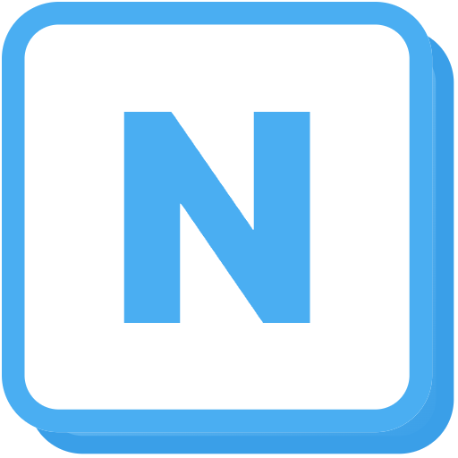

# MyNote

A beautiful workspace for notes, docs and databases that stays yours. Every page is a plain Markdown file on your computer, and your AI agents can read only the pages you share.

[User guide](apps/desktop/src-tauri/seed/Welcome.md) · [Contributing](CONTRIBUTING.md)

[](https://github.com/likeca/MyNote/actions/workflows/ci.yml)
[](LICENSE)

<picture>
  <source media="(prefers-color-scheme: dark)" srcset="apps/lander/public/assets/editor-dark-1440.jpg">
  
</picture>

## Why MyNote

- **Easy to use.** Type `/` for any block: headings, to-dos, callouts, tables, columns and more. Build databases with table, board and calendar views.
- **Your files, on your disk.** Pages are Markdown files in a folder you own, saved to git as you go. Open them in any editor, any time.
- **On every device.** Connect a private git repository and your computers and phone sync on their own in the background. A page changed in two places keeps both versions.
- **AI on your terms.** Connect Claude, Cursor or any MCP client and they can search, read and update your notes. You choose which pages they see, and you can undo anything they change.
- **Plugins for the rest.** Install what you need from the plugin store, on your computer or phone: [Finance](docs/content/plugins/finance.md) for budgets, investments and net worth, or [Media Library](docs/content/plugins/media-library.md) for your project files. Store plugins are signed, and their data stays in your pages. [Build your own](docs/content/developers/plugins.md) in TypeScript and React.

## Install

MyNote isn't published as a download yet, so build it yourself. You need [git](https://git-scm.com), [Node.js 20+](https://nodejs.org) and [Rust](https://rustup.rs). The script checks for anything else it needs.

```sh
git clone https://github.com/likeca/MyNote && cd MyNote
./scripts/install.sh          # macOS and Linux
.\scripts\install.ps1         # Windows (PowerShell)
```

**Android** (preview): Build it with `npm run android:build -w @mynote/mobile` (setup in [CONTRIBUTING.md](CONTRIBUTING.md)), then open **Settings → Sync** to connect the repository your workspace syncs with. The iOS app builds, but isn't distributed yet.

## Connect your AI agents

Click **Connect agents** in the sidebar and copy the setup for Claude Code, Claude Desktop, Cursor or any other MCP client. It shows the exact command for your install. From a source checkout, it looks like this:

```sh
claude mcp add mynote -- node /path/to/MyNote/packages/mcp/dist/index.js --workspace ~/MyNote
```

Every change an agent makes is saved as its own git commit, so you can review or undo it. Hide any page from agents in its `•••` menu. [More about agents](apps/desktop/src-tauri/seed/Welcome/Connect%20your%20AI%20agents.md).

## Learn more

MyNote opens with a Welcome guide that explains every feature. You can also [read it here](apps/desktop/src-tauri/seed/Welcome.md):

[Writing and blocks](apps/desktop/src-tauri/seed/Welcome/Writing%20and%20blocks.md) ·
[Databases](apps/desktop/src-tauri/seed/Welcome/Databases.md) ·
[History and sync](apps/desktop/src-tauri/seed/Welcome/History%20and%20sync.md) ·
[What AI agents can see](apps/desktop/src-tauri/seed/Welcome/What%20AI%20agents%20can%20see.md) ·
[Import](apps/desktop/src-tauri/seed/Welcome/Import.md) ·
[Plugins](apps/desktop/src-tauri/seed/Welcome/Plugins.md) ·
[Your files on disk](apps/desktop/src-tauri/seed/Welcome/Your%20files%20on%20disk.md) ·
[Keyboard shortcuts](apps/desktop/src-tauri/seed/Welcome/Keyboard%20shortcuts.md)

## Status

MyNote is an early preview. Search is basic, databases don't have formulas yet, and there's no sharing or comments. [Ideas and bug reports](https://github.com/likeca/MyNote/issues) are very welcome.

## Contributing

We'd love your help. Start with [CONTRIBUTING.md](CONTRIBUTING.md).

## License

[MIT](LICENSE). MyNote is a fork of [Betelgeuse](https://github.com/devian-labs/betelgeuse) by [Devian Labs](https://devianlabs.com).
