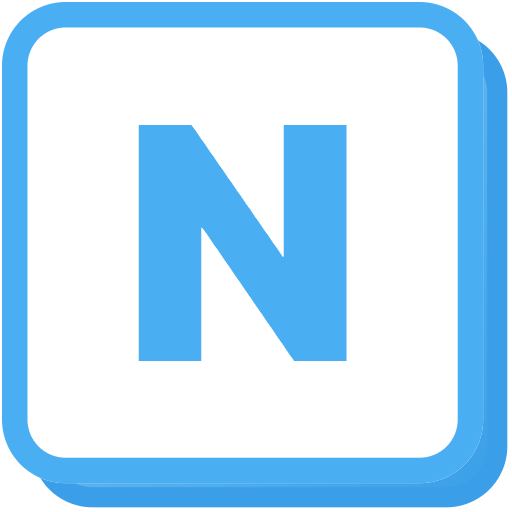

# MyNote

A beautiful workspace for notes, docs and databases that stays yours. Every page is a plain Markdown file on your computer, and your AI agents can read only the pages you share.

[User guide](apps/desktop/src-tauri/seed/Welcome.md) · [Contributing](CONTRIBUTING.md)

[](https://github.com/likeca/MyNote/actions/workflows/ci.yml)
[](LICENSE)

<picture>
  <source media="(prefers-color-scheme: dark)" srcset="apps/lander/public/assets/editor-dark-1440.jpg">
  
</picture>

## Why MyNote

- **Easy to use.** Type `/` for any block: headings, to-dos, callouts, tables, columns and more. Build databases with table, board and calendar views.
- **Your files, on your disk.** Pages are Markdown files in a folder you own, saved to git as you go. Open them in any editor, any time.
- **On every device.** Connect a private git repository and your computers and phone sync on their own in the background. A page changed in two places keeps both versions.
- **AI on your terms.** Connect Claude, Cursor or any MCP client and they can search, read and update your notes. You choose which pages they see, and you can undo anything they change.
- **Plugins for the rest.** Install what you need from the plugin store, on your computer or phone: [Finance](docs/content/plugins/finance.md) for budgets, investments and net worth, or [Media Library](docs/content/plugins/media-library.md) for your project files. Store plugins are signed, and their data stays in your pages. [Build your own](docs/content/developers/plugins.md) in TypeScript and React.

## What MyNote adds

MyNote is a fork of [Betelgeuse](https://github.com/devian-labs/betelgeuse). On top of it, MyNote adds:

- **Pages side by side.** ⌥-click a page in the sidebar, or right-click it and choose **Open side by side**. You can write in both pages, and links on the right side open there. Drag the divider to resize.
- **Run shell and Python in code blocks.** On the desktop, a **Bash**, **Bash + profile**, **Shell**, **Zsh** or **Python** block runs in the workspace folder, with your own `PATH`. Click **Run** for the whole block, or press `Ctrl E` for one line. The output is saved with the page.
- **Terminals.** A terminal tab (`Ctrl` + backtick), or a terminal beside the page (`⌘J`) to keep an AI agent such as Claude Code or oh-my-pi running while you write.
- **File attachments.** Drop, paste or `/File` any file onto a page:
  - each page keeps its files in its own `_assets/` folder, so they move and rename with it;
  - text and code files open in a tab with a VS Code-style editor (Monaco);
  - a deleted file waits in the Trash.
- **Equations and diagrams.** LaTeX block and inline equations (`$$`, `⌘⇧E`), with left alignment. draw.io diagrams, stored as `.drawio.svg` files that draw.io can still open and edit.
- **Link mentions.** Paste a web address and it shows the site's icon and the page's title. A GitHub repository shows its name and its owner's avatar.
- **Toggle headings**, with `Tab` and `⇧Tab` to move blocks into and out of the toggle above.
- **Block selection.** Select whole blocks to delete, copy, cut, colour or convert together:
  - drag from the margin;
  - press `Esc`, then `⇧↑` and `⇧↓` to add blocks;
  - or shift-click.
- **Richer tables.** Drag rows and columns, colour cells, header row and column, fit to page width, resize columns, and turn a table into a database.
- **Resizable images**, saved as Obsidian does (``).
- **Better search.** `⌘K` searches page contents with snippets, opens the page at the match and keeps your last search. `⌘F` finds in the page and opens closed toggles to show matches.
- **Databases with text.** A database page can have ordinary text above and below its views, and you can delete the database while keeping its rows as pages.
- **Upload with `⌘S`.** Commits, pulls and pushes in one step from the cloud button in the sidebar, and syncs on its own in the background.
- **Your own colours.** Tune any theme's colours in **Settings → Appearance**, and zoom page text with `⌘+` and `⌘−`.
- **More AI clients.** The **Connect agents** dialog adds oh-my-pi and Pi to Claude Code, Claude Desktop, Cursor and HTTP.
- **Code block keys.** `Home` and `End` go to the start and end of the line inside a code block.

## Install

MyNote isn't published as a download yet, so build it yourself. You need [git](https://git-scm.com), [Node.js 20+](https://nodejs.org) and [Rust](https://rustup.rs). The script checks for anything else it needs.

```sh
git clone https://github.com/likeca/MyNote && cd MyNote
./scripts/install.sh          # macOS and Linux
.\scripts\install.ps1         # Windows (PowerShell)
```

**Android** (preview): Build it with `npm run android:build -w @mynote/mobile` (setup in [CONTRIBUTING.md](CONTRIBUTING.md)), then open **Settings → Sync** to connect the repository your workspace syncs with. The iOS app builds, but isn't distributed yet.

### Build it yourself

The install scripts run these commands; run them yourself to build without installing, or to update a copy you built before. The first build takes a few minutes. Every build also builds the MCP server that ships inside the app.

**macOS** needs the Xcode Command Line Tools (`xcode-select --install`), Node.js 20+ and Rust:

```sh
npm ci
npm run tauri -w @mynote/desktop -- build --bundles app    # or --bundles dmg for a disk image
```

The app is `target/release/bundle/macos/MyNote.app`. To install it, quit MyNote, then:

```sh
rm -rf /Applications/MyNote.app
cp -R target/release/bundle/macos/MyNote.app /Applications/
xattr -dr com.apple.quarantine /Applications/MyNote.app
```

**Windows** needs Node.js 20+, Rust and the **Desktop development with C++** workload from [Visual Studio Build Tools](https://visualstudio.microsoft.com/visual-cpp-build-tools/). WebView2 comes with Windows 10 and 11. In PowerShell:

```powershell
npm ci
npm run tauri -w @mynote/desktop -- build --bundles nsis   # or --bundles msi (needs the WiX Toolset)
```

The installer is `target\release\bundle\nsis\MyNote_<version>_x64-setup.exe`; run it to install or update MyNote.

To run MyNote from the source while you work on it, with changes showing as you save, use `npm run app`.

## Connect your AI agents

Click **Connect agents** in the sidebar and copy the setup for Claude Code, Claude Desktop, Cursor or any other MCP client. It shows the exact command for your install. From a source checkout, it looks like this:

```sh
claude mcp add mynote -- node /path/to/MyNote/packages/mcp/dist/index.js --workspace ~/MyNote
```

Every change an agent makes is saved as its own git commit, so you can review or undo it. Hide any page from agents in its `•••` menu. [More about agents](apps/desktop/src-tauri/seed/Welcome/Connect%20your%20AI%20agents.md).

## Learn more

MyNote opens with a Welcome guide that explains every feature. You can also [read it here](apps/desktop/src-tauri/seed/Welcome.md):

[Writing and blocks](apps/desktop/src-tauri/seed/Welcome/Writing%20and%20blocks.md) ·
[Databases](apps/desktop/src-tauri/seed/Welcome/Databases.md) ·
[History and sync](apps/desktop/src-tauri/seed/Welcome/History%20and%20sync.md) ·
[What AI agents can see](apps/desktop/src-tauri/seed/Welcome/What%20AI%20agents%20can%20see.md) ·
[Import](apps/desktop/src-tauri/seed/Welcome/Import.md) ·
[Plugins](apps/desktop/src-tauri/seed/Welcome/Plugins.md) ·
[Your files on disk](apps/desktop/src-tauri/seed/Welcome/Your%20files%20on%20disk.md) ·
[Keyboard shortcuts](apps/desktop/src-tauri/seed/Welcome/Keyboard%20shortcuts.md)

## Status

MyNote is an early preview. Search is basic, databases don't have formulas yet, and there's no sharing or comments. [Ideas and bug reports](https://github.com/likeca/MyNote/issues) are very welcome.

## Contributing

We'd love your help. Start with [CONTRIBUTING.md](CONTRIBUTING.md).

## License

[MIT](LICENSE). MyNote is a fork of [Betelgeuse](https://github.com/devian-labs/betelgeuse) by [Devian Labs](https://devianlabs.com).
